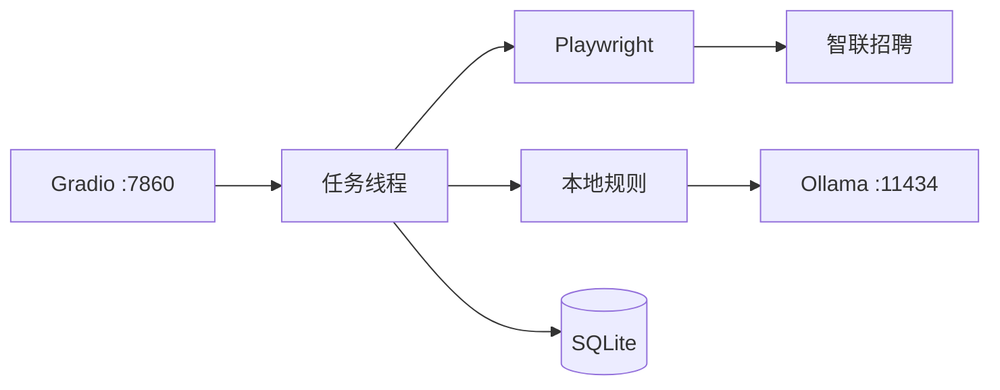
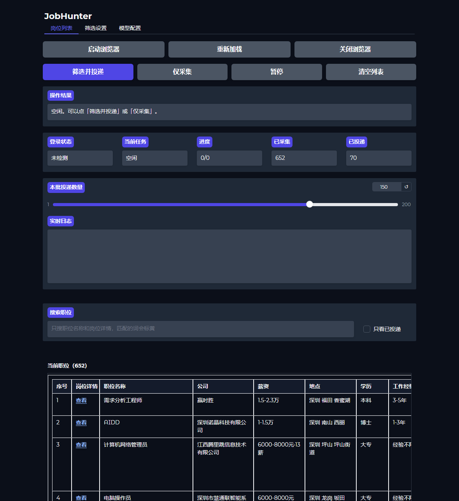
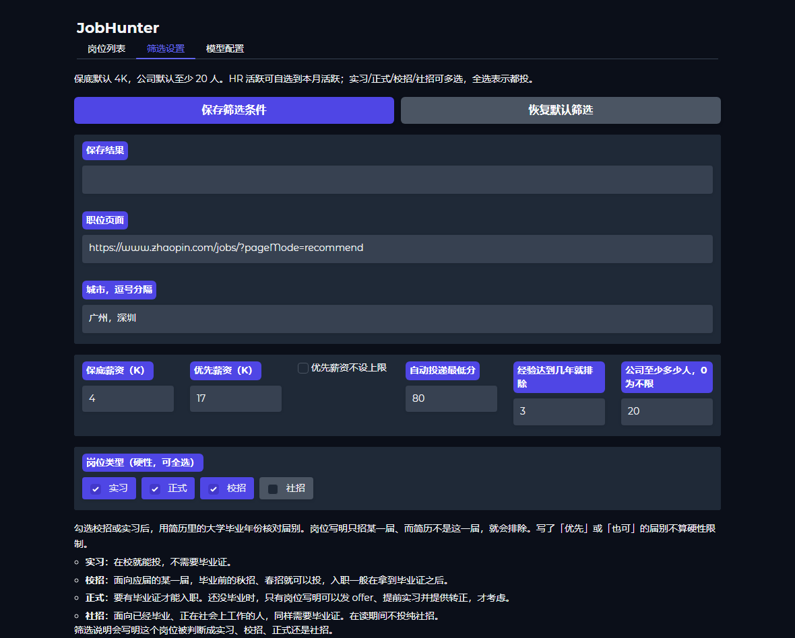
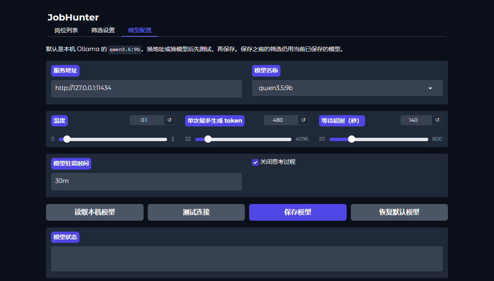

# JobHunter

JobHunter 在本机完成智联招聘职位的采集、筛选与投递。浏览器保持可见，登录与验证由使用者在页面中完成。本地规则先排除不符合条件的职位，本机模型再对剩余职位打分，达到分数线后自动点击「立即投递」。

## 技术栈

| 模块 | 实现 |
| --- | --- |
| 界面 | Gradio，Soft 主题 |
| 浏览器 | Playwright 持久化 Chromium，有界面 |
| 采集 | 读取当前列表与侧栏详情，解析职位名称、公司、薪资、地点、学历、经验、规模、HR 活跃和职位描述 |
| 规则筛选 | `core/rules.py`，不调用模型 |
| 模型打分 | Ollama `/api/chat`，输出 JSON |
| 投递 | 侧栏为「立即投递」时执行点击。已是「继续沟通」的记为筛选前已投递 |
| 存储 | SQLite，WAL |

## 架构



## 端口

| 地址 | 用途 |
| --- | --- |
| http://127.0.0.1:7860 | 操作界面 |
| http://127.0.0.1:11434 | Ollama。地址可在「模型配置」中修改 |

## 项目结构

```text
app.py                         界面与按钮
requirements.txt
config/profile.example.json    首次运行使用的配置模板
core/
  browser.py                   启动、关闭与重新加载浏览器
  collector.py                 列表采集。当前页没有新职位时停止
  job_parser.py                解析智联页面
  rules.py                     薪资、城市、经验、规模、HR 活跃、届别与岗位类型
  ai_filter.py                 调用 Ollama，并解析 JSON 评分
  application.py               判断分数是否达到自动投递线
  auto_apply.py                点击投递按钮
  database.py                  职位、投递记录与简历正文
  task_manager.py              采集、筛选与投递的任务循环
  resume_parser.py             从 PDF 提取正文
  defaults.py                  默认筛选条件与默认模型
  profile_store.py             读写 config/profile.json
scripts/check_ollama.py        检查模型能否返回 JSON
tests/                         pytest
```

## 环境与启动

运行环境为 Python 3.11 及以上。本机需已启动 Ollama，并能够弹出 Chromium 窗口。

```powershell
pip install -r requirements.txt
python -m playwright install chromium
ollama pull qwen3.5:9b
python app.py
```

在浏览器中打开 http://127.0.0.1:7860 。首次运行会按 `config/profile.example.json` 生成 `config/profile.json`。智联招聘的登录、短信与验证在弹出的窗口中手动完成。

检查模型是否在线：

```powershell
python scripts/check_ollama.py
```

该脚本只发送一句测试，不携带简历。界面中的「测试连接」使用当前表单里的地址和模型，作用相同。

## 使用说明

界面分为「岗位列表」「筛选设置」和「模型配置」。标题与页签固定在顶部，下方内容单独滚动。

### 岗位列表

岗位列表集中放置浏览器控制、任务状态和职位表。



| 按钮 | 作用 |
| --- | --- |
| 启动浏览器 | 打开持久化浏览器，并检测智联登录状态 |
| 重新加载 | 刷新当前智联页面。有任务在执行时不可用 |
| 关闭浏览器 | 关闭浏览器，并清空当前职位列表 |
| 筛选并投递 | 先筛选已采集职位，再从当前页面继续采集。达到分数后投递。执行中变为「停止投递」，当前职位处理完后恢复 |
| 仅采集 | 只采集当前页面，不投递。执行中变为「停止采集」 |
| 暂停 | 暂停当前任务 |
| 清空列表 | 清空职位表，不会接着自动采集 |

「本批投递数量」是本轮目标，默认 150，最大 200。「进度」按本轮计算。「已采集」和「已投递」是本次进程启动后的累计，新开一轮不会把这两个数清零。

当前页没有新职位时，本轮投递停止，浏览器保持打开。在智联页面调整条件并刷出新职位后，再点击「筛选并投递」。

退出程序时会清空简历正文。筛选条件与模型配置保留在 `config/profile.json`。

### 搜索与详情

搜索只匹配职位名称和岗位详情。命中的文字会高亮，名称下方带出详情中的匹配片段。「只看已投递」只保留已经投出的记录，可以和关键词一起使用。


点击「查看」打开详情，职位描述位于最上方。点击弹窗外部关闭。

侧栏按钮为「继续沟通」时，该职位记为筛选前已投递；为「立即投递」时，记为筛选前未投递。结果写入筛选说明。

### 筛选设置

在本页修改条件后，点击「保存筛选条件」。「恢复默认筛选」会恢复 `core/defaults.py` 中的筛选默认值，已保存的模型配置保持不变。



硬性条件在本地判断，未通过的职位不会交给模型。通过的职位由 Ollama 打分，达到「自动投递最低分」（默认 80）后自动投递。

薪资分为保底和优先两档。职位薪资上限低于保底时排除。未勾选「优先薪资不设上限」时，下限高于优先薪资的职位会被排除；勾选后不按上限排除。

岗位类型可以多选：实习、正式、校招、社招。四项都选中表示全部允许。

勾选校招或实习后，使用简历或画像中的毕业年份核对届别。职位限定届别且年份不符时排除。写有「优先」或「也可」的届别不是硬性条件。正式和社招默认要求已毕业。尚未毕业时，只保留写明可以发放 offer、提前实习并提供转正的职位。筛选说明的开头会写明岗位属性。

公司规模、HR 活跃、城市、经验年限、目标岗位和屏蔽词也在本页配置。HR 活跃早于所选下限的职位不投递。简历 PDF 只用于打分，程序退出时正文会被清除。

### 模型配置

模型配置位于「筛选设置」旁边。打分请求发往 Ollama 的 `/api/chat`，响应格式为 JSON。默认模型是本机的 `qwen3.5:9b`。使用前请执行 `ollama pull qwen3.5:9b`。向量模型不能用于打分。



| 配置项 | 默认值 | 说明 |
| --- | --- | --- |
| 服务地址 | `http://127.0.0.1:11434` | Ollama 服务地址 |
| 模型名称 | `qwen3.5:9b` | 可直接填写，或点击「读取本机模型」从已安装模型中选择 |
| 温度 | `0.1` | 使同一职位的分数保持稳定 |
| 单次最多生成 token | `480` | 一条评分 JSON 的生成上限。常规结果约为 200 到 400 个 token |
| 等待超时 | `140` 秒 | 超时后跳过当前职位并继续下一个，不在同一条上重试 |
| 模型驻留时间 | `30m` | 连续筛选时将模型保留在内存中 |
| 关闭思考过程 | 开启 | 只生成 JSON。思考过程会计入生成长度和等待时间 |

「测试连接」按当前表单发送一条短请求，不修改已保存的配置。「保存模型」之后的筛选使用这份配置，无需重启。「恢复默认模型」回到上表中的默认值。

尚未保存时，缺失字段使用上表的默认值。环境变量 `OLLAMA_HOST` 和 `OLLAMA_MODEL` 只在配置中没有对应字段时生效。

模型在 CPU 上运行时，生成速度约为每秒 5 个 token，一条评分大约需要一分钟。界面会标明正在评分的职位。点击「停止投递」会立即断开这次模型调用。

## 测试

```powershell
python -m pytest -q
```
