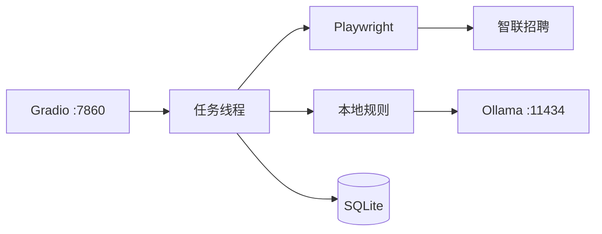
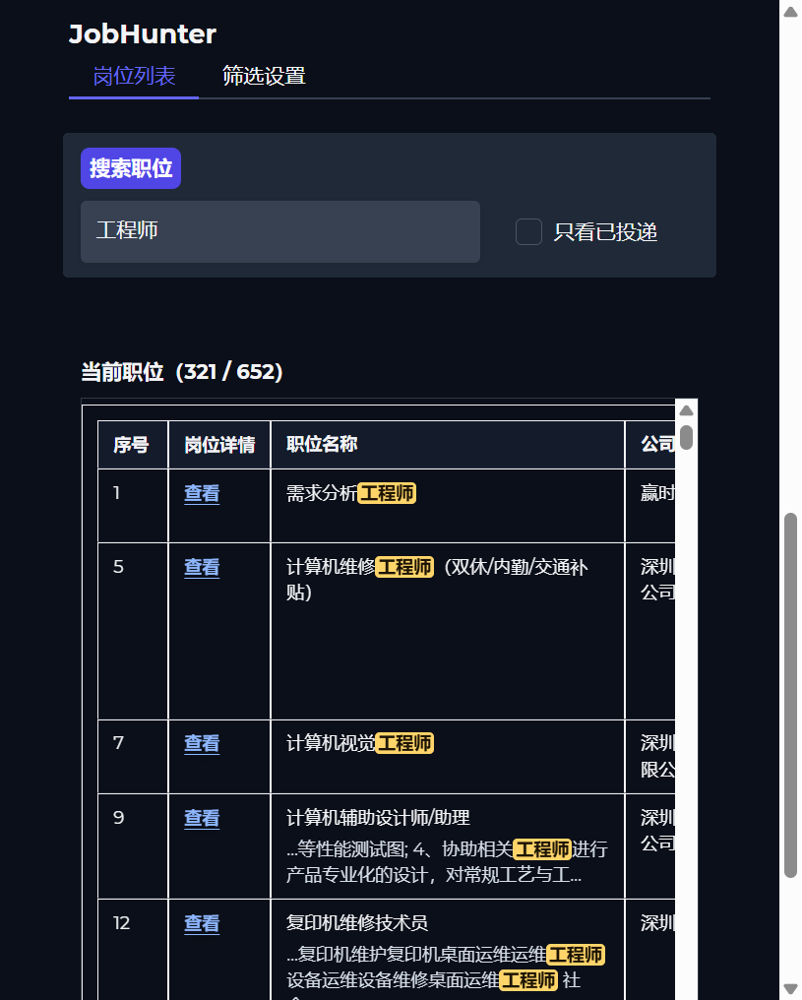
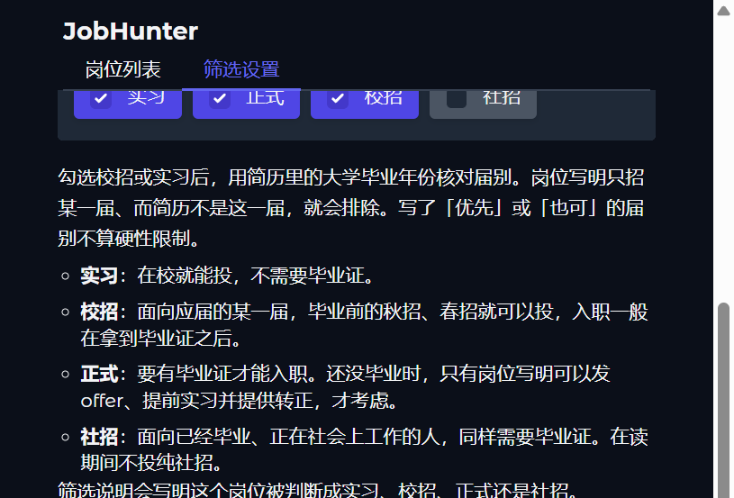

# JobHunter

在本机采集智联招聘职位，用规则和本地模型筛选，再对通过的职位点击「立即投递」。

界面是 Gradio，浏览器自动化是 Playwright，职位存在 SQLite，打分走本机 Ollama。

## 技术

| 部分 | 实现 |
| --- | --- |
| 界面 | Gradio，主题 Soft |
| 浏览器 | Playwright 持久化 Chromium，有界面 |
| 采集 | 读取当前列表和侧栏详情，解析职位名称、公司、薪资、地点、学历、经验、规模、HR 活跃和职位描述 |
| 硬性筛选 | `core/rules.py`，不调用模型 |
| 打分 | Ollama `/api/chat`，`format` 为 JSON |
| 投递 | 在侧栏点击「立即投递」。按钮已是「继续沟通」的记为筛选前已投递 |
| 存储 | SQLite，WAL |



## 端口

| 地址 | 用途 |
| --- | --- |
| http://127.0.0.1:7860 | 操作界面 |
| http://127.0.0.1:11434 | Ollama。在「模型配置」里改地址 |
| 模型名 | 默认 `qwen3.5:9b`，在「模型配置」里改 |

## 项目结构

```text
app.py                      Gradio 页面和按钮
requirements.txt
config/profile.example.json 第一次运行用的筛选模板
core/
  browser.py                启动、关闭、重新加载浏览器
  collector.py              翻页采集，当前页没有新职位就停
  job_parser.py             解析智联页面
  rules.py                  薪资、城市、经验、公司规模、HR 活跃、届别、岗位类型
  ai_filter.py              调用 Ollama，整理 JSON 分数
  application.py            分数是否达到自动投递线
  auto_apply.py             点击投递按钮
  database.py               职位、投递记录、简历正文
  task_manager.py           采集、筛选、投递的任务循环
  resume_parser.py          从 PDF 抽出正文
  defaults.py               默认筛选条件和默认模型
  profile_store.py          读写 config/profile.json
scripts/check_ollama.py     检查模型能否返回 JSON
tests/                      pytest
```

## 环境

Python 3.11 及以上，本机已启动 Ollama，并且能弹出 Chromium。

```powershell
pip install -r requirements.txt
python -m playwright install chromium
ollama pull qwen3.5:9b
python app.py
```

浏览器打开 http://127.0.0.1:7860 。第一次运行会按 `config/profile.example.json` 写出 `config/profile.json`。智联的登录、短信和验证在弹出的窗口里手动完成。

检查模型是否在线：

```powershell
python scripts/check_ollama.py
```

这个脚本只发一句测试，不带简历。界面里的「测试连接」做的是同一件事，并且用的是当前表单里的地址和模型。

## 使用

界面分「岗位列表」「筛选设置」和「模型配置」。标题和页签固定在上面。


浏览器控制在第一行：「启动浏览器」「重新加载」「关闭浏览器」。

第二行：

| 按钮 | 作用 |
| --- | --- |
| 筛选并投递 | 主操作。先筛已经采集的职位，再从当前智联页面继续采集。达到分数才投递。运行中变成灰色「停止投递」，当前这条处理完才变回来。 |
| 仅采集 | 只抓当前页，不投递。运行中变成「停止采集」。 |
| 暂停 | 暂停当前任务。 |
| 清空列表 | 清空职位表，不会接着自动采集。 |

「本批投递数量」是这一轮的目标，默认 150，最大 200。「进度」按这一轮计算。「已采集」和「已投递」是这次进程启动以来的累计，新开一轮不会把这两个数清零。

当前页没有新职位时，投递停止，浏览器保持打开。在智联页面上改条件、刷出新职位后，再点「筛选并投递」。

关闭浏览器会清空当前职位列表。退出程序会清空简历正文，筛选条件仍留在 `config/profile.json`。

### 搜索和详情

搜索框只匹配职位名称和岗位详情。命中的词会标黄。名称下面会带出详情里的一小段。勾选「只看已投递」只留已经投出的行。两个条件可以一起用。

点「查看」打开详情，职位描述在最上面。点弹窗外面关闭。



侧栏按钮是「继续沟通」时，这条记为筛选前已投递；是「立即投递」时，记为筛选前未投递。筛选说明里会带上这个结果。

### 筛选设置

在这一页改条件，点「保存筛选条件」。点「恢复默认筛选」会回到 `core/defaults.py`。

硬性条件在本地判断，不通过的不交给模型。通过的由 Ollama 打分，分数达到「自动投递最低分」（默认 80）才自动点击投递。

薪资看两档。上限低于保底则排除。没有勾选「优先薪资不设上限」时，下限高于优先薪资则排除；勾选后不按上限排除。

岗位类型可以多选：实习、正式、校招、社招。全选表示四种都允许。



勾选了校招或实习时，用简历或画像里的大学毕业年份核对届别。职位写明只招某一届、而年份对不上，就排除。写了「优先」或「也可」的届别不是硬性条件。正式和社招默认要已毕业；还没毕业时，只有职位写明可以发 offer、提前实习并提供转正才保留。筛选说明开头会写岗位属性。

公司人数、HR 活跃、城市、经验年限、目标岗位和屏蔽词也在这一页。HR 活跃比所选下限更旧的不投。简历 PDF 只用于打分，程序退出时正文会被清掉。

### 模型配置

在「筛选设置」旁边。打分走 Ollama 的 `/api/chat`，`format` 为 JSON。默认是本机的 `qwen3.5:9b`，先执行 `ollama pull qwen3.5:9b`。向量模型不能用来打分。


| 项 | 默认 | 作用 |
| --- | --- | --- |
| 服务地址 | `http://127.0.0.1:11434` | Ollama 地址 |
| 模型名称 | `qwen3.5:9b` | 可直接填写，或点「读取本机模型」从该地址已安装的模型里选 |
| 温度 | `0.1` | 同一职位的分数保持稳定 |
| 单次最多生成 token | `480` | 一条评分 JSON 的上限。正常结果大约 200 到 400 个 token |
| 等待超时 | `140` 秒 | 到时间就跳过这一条，继续下一个，不在同一条上重试 |
| 模型驻留时间 | `30m` | 连续筛选时模型留在内存里，避免每次重新加载 |
| 关闭思考过程 | 开 | 只生成 JSON。思考过程会计入上面的 token 和等待时间 |

「测试连接」按当前表单发一句短请求，不改已保存的配置。「保存模型」之后的筛选使用这份配置，不用重启程序。「恢复默认模型」回到上表。「恢复默认筛选」不会清掉这里的模型配置。

还没保存时，缺的字段用上表。环境变量 `OLLAMA_HOST` 和 `OLLAMA_MODEL` 只在配置里没有对应字段时生效。

模型跑在 CPU 上时，生成速度大约每秒 5 个 token，一条评分大约一分钟。界面会写明正在看哪个职位，这条结束再继续下一条。点「停止投递」会立刻断开这次模型调用。

## 测试

```powershell
python -m pytest -q
```
